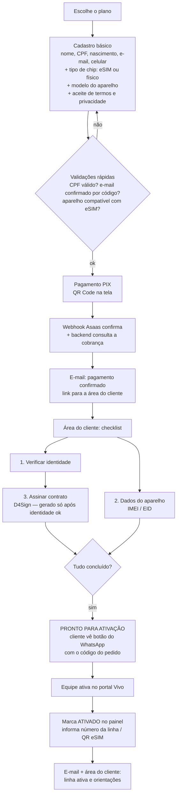

# 01 — Análise estratégica

## 1. Diagnóstico da ideia

A ideia é boa e o recorte está certo: **automatizar tudo em volta da ativação e manter a ativação
manual**. O ganho não vem de "ter um site", vem de três coisas:

1. O cliente fornece cada dado **uma única vez**, num lugar só, guiado passo a passo.
2. O sistema **cobra sozinho** o que está faltando (lembretes automáticos).
3. O pai abre o painel e vê uma **fila de "prontos para ativar"** com tudo conferido.

### Problemas e riscos na ideia original

| # | Ponto | Por que é um problema | Proposta |
|---|-------|----------------------|----------|
| 1 | **Pagar antes de qualquer validação** | Se a identidade for recusada, o aparelho for incompatível com eSIM ou a Vivo negar a ativação, você precisa estornar. Estorno custa tempo, taxa e gera reclamação. | Coletar cadastro básico e checar compatibilidade **antes** do pagamento (é barato e rápido). Validação forte de identidade fica depois do pagamento (é cara). |
| 2 | **Validação de identidade duplicada** | A Anatel aprovou (out/2026) biometria facial com prova de vida obrigatória para ativar linhas. É muito provável que a Vivo faça isso no próprio fluxo de ativação. Pagar um provedor de biometria para repetir o mesmo processo é custo e dado sensível a mais. | Primeiro perguntar à Vivo como o canal de parceiros fará a biometria. Só contratar provedor próprio se for exigido ou se o risco de fraude justificar. |
| 3 | **Selfie e documentos por e-mail/WhatsApp** | Hoje os documentos ficam espalhados em e-mails e conversas, sem controle de acesso, sem prazo de exclusão. Isso é o maior risco de LGPD da operação atual. | Documentos só entram por canal seguro (provedor de identidade ou área logada). Nunca anexos de e-mail, nunca link público. |
| 4 | **Rate limit da D4Sign** | A documentação da D4Sign cita limite padrão de 10 requisições/hora. Isso dá ~2 contratos por hora. | Pedir aumento ao suporte antes de lançar; enfileirar envios para nunca estourar o limite. |
| 5 | **Cartão de crédito em produto de risco** | Linha telefônica é alvo clássico de fraude (golpes, contas "laranja"). Chargeback de cartão depois da linha ativada é prejuízo certo. | MVP só com **PIX**. Cartão entra depois, com regras antifraude. |
| 6 | **Uso da marca Vivo** | Parecer o site oficial pode violar o contrato de parceria e a lei de marcas, e assusta o cliente quando ele descobre que não é. | Identidade visual própria (GIGACHIP), aviso claro de "parceiro/revendedor", domínio sem "vivo", e só usar logotipo se a parceria autorizar por escrito. |
| 7 | **"Dados de entrega" da linha** | O QR Code de eSIM é uma credencial: quem tiver o QR ativa a linha. Mandar por e-mail é arriscado. | Entregar o QR na área logada do cliente, com acesso registrado. |
| 8 | **Recorrência indefinida** | Ainda não está claro quem cobra a mensalidade (Vivo ou vocês). | Modelar o banco para suportar os dois, mas o MVP só implementa cobrança única até a resposta vir. |

### Oportunidades além do pedido

- **Validação automática de IMEI** pelo dígito verificador (algoritmo de Luhn) — pega erro de digitação na hora, sem OCR.
- **Validação de EID**: 32 dígitos com dígitos verificadores (mod 97). Também pega erro de digitação. *(Confirmar com amostras reais de aparelhos.)*
- **Checagem de compatibilidade eSIM antes da compra**: o cliente informa marca/modelo e o sistema alerta se o aparelho não suporta eSIM.
- **Pedido "pronto" calculado pelo banco**, não por alguém clicando — elimina esquecimento.
- **Link de WhatsApp sem dados pessoais**: só o código do pedido (`GC-2026-00123`). O atendente busca no painel.
- **Métricas de funil** (quantos param em cada etapa) — mostra onde o processo está perdendo clientes.
- **Base para crescer**: programa de indicação, revendedores secundários, outras operadoras, portabilidade — o modelo de dados já nasce preparado.

## 2. Jornada proposta para o cliente

Princípio: **barato e rápido antes do pagamento, caro e sensível depois**. E permitir que as etapas
pós-pagamento independentes aconteçam em qualquer ordem.

Pontos importantes:

- **O contrato é gerado depois da identidade aprovada**, porque é preenchido com dados validados.
- **Dados do aparelho podem ser informados a qualquer momento após o pagamento**, em paralelo.
- O botão do WhatsApp aparece **o tempo todo** para tirar dúvidas, mas a mensagem pré-preenchida de
  "solicitar ativação" só aparece quando o pedido está pronto (evita conversa inútil).
- A área do cliente usa login por **código enviado ao e-mail** (sem senha para esquecer).

## 3. O que é automático e o que continua manual

| Etapa | Automático | Manual | Observação |
|-------|:---------:|:------:|------------|
| Catálogo, comparação, página do plano | ✅ | | Planos editados no painel |
| Cadastro e validação de formato (CPF, e-mail, telefone) | ✅ | | |
| Criação da cobrança PIX | ✅ | | Asaas API |
| Confirmação do pagamento | ✅ | | Webhook + consulta à API |
| E-mails de cada etapa e lembretes | ✅ | | |
| Verificação de identidade | ✅ (provedor) | ⚠️ exceções | Casos "em análise"/recusados podem precisar de olhar humano |
| Geração e envio do contrato | ✅ | | Depende do plano D4Sign ter API |
| Acompanhamento da assinatura | ✅ | | Webhook D4Sign |
| Coleta e validação de IMEI/EID | ✅ | | Luhn / mod 97 |
| Marcar "pronto para ativação" | ✅ | | Calculado pelo sistema |
| **Ativação no portal Vivo** | | ✅ | Sem API autorizada — continua manual |
| Informar número/QR eSIM ao sistema | | ✅ | Formulário no painel |
| Envio da confirmação ao cliente | ✅ | | Disparado ao marcar "ativado" |
| Envio de chip físico | | ✅ | Depende da logística definida |
| Estornos, recusas, fraudes, disputas | | ✅ | Painel mostra a fila de exceções |
| Atendimento no WhatsApp | | ✅ | MVP; automação de notificações na fase 2 |

## 4. Riscos principais

| Risco | Probabilidade | Impacto | Mitigação |
|-------|:---:|:---:|-----------|
| Contrato de parceria não permite venda online ou uso de marca | Média | **Crítico** | Confirmar por escrito antes de qualquer investimento (doc 00) |
| Vazamento de dados pessoais/documentos | Média | **Crítico** | Não armazenar o que não precisa; RLS no banco; criptografia de campos; MFA na equipe; logs de acesso |
| Fraude (identidade falsa, PIX de terceiros, chargeback) | Alta | Alto | PIX no MVP; verificação de identidade; titular do pagamento = titular da linha (conferir); limite por CPF |
| API da D4Sign limitada no plano atual | Média | Médio | Testar no sandbox na fase 0; plano B: gerar PDF próprio + upload |
| Webhook perdido → pedido pago parado | Baixa | Alto | Tabela de eventos idempotente + rotina de reconciliação que consulta o Asaas periodicamente |
| Mudança das regras da Anatel/Vivo para biometria | Alta | Médio | Etapa de identidade isolada atrás de uma interface "provedor de identidade" — trocar o provedor não muda o resto |
| Dependência de uma ferramenta no-code | Média | Médio | Código próprio no GitHub, sem lock-in (ver doc 03) |
| Cliente não consegue achar IMEI/EID | Alta | Baixo | Instruções por marca (iPhone/Android) com imagens; botão de ajuda no WhatsApp |
