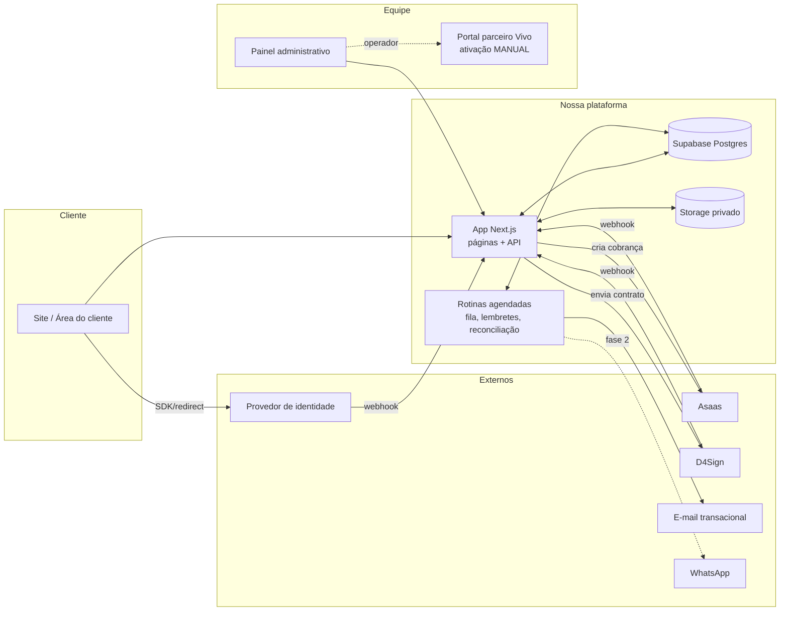

# 02 — Integrações

Regra deste documento: **separar o que está documentado publicamente do que ainda precisa ser
testado**. Nada marcado "a confirmar" deve virar código antes de um teste em sandbox.

Legenda: ✅ documentado publicamente · 🧪 a confirmar em sandbox/suporte · ❓ depende de plano/contrato

---

## 1. Asaas (pagamentos)

**Documentação:** https://docs.asaas.com

| Necessidade | Como | Status |
|-------------|------|:------:|
| Ambiente de testes | Sandbox separado, chave de API própria | ✅ |
| Cadastrar cliente | `POST /v3/customers` (nome, CPF) | ✅ |
| Criar cobrança PIX | `POST /v3/payments` com `billingType=PIX`, `externalReference` = id do nosso pedido | ✅ |
| Mostrar QR Code PIX no nosso site | `GET /v3/payments/{id}/pixQrCode` | ✅ |
| Cartão de crédito | Usar a **página de fatura do Asaas** (`invoiceUrl`) em vez de capturar o cartão no nosso site — assim os dados do cartão nunca passam pelos nossos servidores (fora do escopo PCI) | ✅ / ❓ cartão habilitado na conta |
| Assinaturas (recorrência) | `POST /v3/subscriptions` | ✅ / ❓ só se o modelo de negócio exigir |
| Webhooks | Configurados por API ou painel; autenticação por **token fixo** que o Asaas envia no header `asaas-access-token` (32–255 caracteres). **Não é assinatura HMAC**, então tratar o token como segredo e comparar em tempo constante | ✅ |
| Eventos de pagamento | `PAYMENT_CREATED`, `PAYMENT_CONFIRMED`, `PAYMENT_RECEIVED`, `PAYMENT_OVERDUE`, `PAYMENT_REFUNDED`, `PAYMENT_DELETED`, eventos de chargeback, entre outros | ✅ |
| Qual evento significa "pago" para PIX × cartão | Cartão costuma passar por `CONFIRMED` antes de `RECEIVED`. Para PIX, testar no sandbox qual sequência chega | 🧪 |
| Reentrega de webhooks | O Asaas reenvia em caso de falha e a fila pode pausar após erros repetidos | ✅ (detalhes de pausa: 🧪) |

### Regras de implementação (inegociáveis)

1. **Pedido só vira "pago" no backend**, nunca por retorno à página de sucesso.
2. Ao receber um webhook: validar o token → gravar o evento bruto em `webhook_events` com o `id` do
   evento como chave única (ignora duplicados) → responder 200 rápido → processar depois.
3. No processamento: **consultar `GET /v3/payments/{id}`** e confiar no status retornado pela API,
   não só no corpo do webhook. Conferir valor e `externalReference`.
4. **Uma cobrança por pedido**: o pedido guarda o `asaas_payment_id`; se já existe cobrança pendente,
   reutiliza. Índice único no banco impede duplicidade mesmo com cliques duplos.
5. **Reconciliação**: rotina a cada X minutos busca pedidos "aguardando pagamento" com cobrança criada
   há mais de N minutos e consulta o Asaas. Cobre webhooks perdidos.
6. Cobrança PIX com vencimento curto; pedido expira automaticamente depois do prazo.

---

## 2. D4Sign (contratos)

**Documentação:** https://docapi.d4sign.com.br

| Necessidade | Como | Status |
|-------------|------|:------:|
| Autenticação | `tokenAPI` + `cryptKey` | ✅ / ❓ plano com API |
| Sandbox | `https://sandbox.d4sign.com.br/api/v1` (produção: `secure.d4sign.com.br/api/v1`) | ✅ |
| Limite de requisições | Padrão citado na documentação: **10 por hora** | ✅ — **pedir aumento** |
| Enviar documento (PDF) para um cofre | Upload de documento | ✅ |
| Cadastrar signatário | `POST /documents/{uuid}/createlist` | ✅ |
| Enviar para assinatura | `POST /documents/{uuid}/sendtosigner` | ✅ |
| Webhook por documento | Endpoint de registro de webhook (POSTBack). A D4Sign reenvia; o evento só se perde se a URL ficar fora do ar por mais de 27 h | ✅ |
| Segurança do webhook | Há página de "Segurança de webhook" na documentação — ler e implementar a verificação indicada | 🧪 |
| Gerar documento a partir de **modelo com campos variáveis** | Existe recurso de templates na D4Sign, mas não encontrei documentação pública suficiente sobre o endpoint, formato do modelo e plano necessário | 🧪 ❓ |
| Autenticação do signatário (SMS, WhatsApp, foto de documento, selfie) | Opções existem na plataforma; confirmar quais estão no plano e se têm custo por uso | 🧪 ❓ |
| Baixar o documento assinado | Endpoint de download do documento | ✅ / 🧪 formato |

### Decisão recomendada para o contrato

**Plano A (preferido se o plano permitir):** usar o modelo existente da D4Sign com campos variáveis.

**Plano B (funciona com qualquer plano que tenha API):** o nosso sistema guarda o modelo do contrato
(versionado), preenche os campos e gera o PDF; envia por upload para a D4Sign. Vantagens: controle
total da versão do contrato e independência do recurso de templates. Desvantagem: o modelo sai do
editor da D4Sign e passa a ser mantido no sistema.

Em ambos os casos guardamos: `document_uuid` da D4Sign, versão do modelo usada, hash do PDF,
datas de envio/assinatura e uma cópia do PDF assinado (com o relatório de assinaturas) num storage
privado.

### Fila de envio

Por causa do limite de requisições, envios para a D4Sign passam por uma fila com controle de taxa.
Se o limite estourar, o contrato fica "aguardando envio" e o sistema tenta de novo — o cliente vê
"seu contrato está sendo preparado".

---

## 3. Verificação de identidade (KYC)

### Recomendação: provedor externo, **não** armazenar biometria nós mesmos

Selfie com prova de vida e foto de documento são **dados pessoais sensíveis** (LGPD art. 11).
Guardar isso no nosso banco traz obrigação de segurança, retenção e resposta a incidentes que uma
operação pequena não precisa assumir. Um provedor especializado:

- captura selfie e documento no SDK/página dele (a imagem não passa pelo nosso servidor);
- faz prova de vida e comparação com bases;
- devolve um **resultado** (aprovado / recusado / em análise) + um identificador do processo.

Nós guardamos **só o status, o identificador e a data**. Se precisar ver a evidência, abre no painel
do provedor.

Provedores brasileiros conhecidos para cotar (não verifiquei preços nem recursos de cada um):
unico, idwall, CAF (Combate à Fraude), Serpro Datavalid (validação contra bases do governo).
Critérios de escolha: preço por verificação, prova de vida certificada, webhook de resultado,
retenção configurável, contrato de operador de dados (LGPD), servidor no Brasil.

### Antes de contratar: pergunta à Vivo (doc 00)

Com a norma de biometria da Anatel, existe uma boa chance de a própria Vivo fazer a biometria
na ativação. Cenários:

| Cenário | O que fazemos |
|---------|---------------|
| Vivo faz a biometria no fluxo de ativação | Nossa etapa vira "validação leve": CPF válido + nome/nascimento conferidos + titularidade do PIX. Sem provedor de biometria. |
| Vivo exige que o parceiro colete | Contratar provedor externo; nossa etapa vira "Verificar identidade" com SDK do provedor. |
| Indefinido no lançamento | MVP com **etapa manual assistida**: cliente envia documento + selfie por upload seguro (bucket privado, criptografado, excluído após a ativação + prazo legal) e a equipe aprova no painel. Interface preparada para trocar por provedor depois. |

A arquitetura trata identidade como uma **interface com implementações trocáveis**
(`manual`, `provedor_x`), então essa decisão não trava o resto do desenvolvimento.

---

## 4. E-mail transacional

Opções boas e simples: **Resend**, **Postmark**, **Amazon SES**. Recomendo Resend ou Postmark pela
simplicidade (SES é mais barato em volume, mas mais trabalhoso de configurar).

Obrigatório:
- domínio próprio com **SPF, DKIM e DMARC** configurados (senão cai no spam);
- e-mails **sem dados pessoais** além do primeiro nome e do código do pedido;
- **nunca** anexar documento, contrato com dados ou QR de eSIM — sempre link para a área logada;
- links de e-mail levam ao login por código; o link em si não dá acesso a dados.

---

## 5. WhatsApp

### MVP: link `wa.me` (custo zero, sem aprovação)

```
https://wa.me/55XXXXXXXXXXX?text=Olá!%20Quero%20solicitar%20a%20ativação%20do%20pedido%20GC-2026-00123
```

Só o código do pedido. O atendente busca o pedido no painel (logado) e, se precisar confirmar que é
o titular, pede os 4 últimos dígitos do celular cadastrado — nunca CPF completo pelo chat.

### Fase 2: WhatsApp Business Platform (Cloud API) para notificações

| Ponto | Situação |
|-------|----------|
| Acesso | Direto pela Meta (Cloud API) ou por um BSP (provedor parceiro). Direto é mais barato; BSP dá painel e suporte |
| Verificação do negócio | Business Manager verificado, número dedicado (não pode estar em uso no app WhatsApp comum ao mesmo tempo) |
| Mensagens iniciadas pela empresa | Só com **modelos (templates) aprovados** pela Meta, categoria "utilidade" para avisos de pedido |
| Consentimento | Opt-in explícito do cliente no cadastro, registrado com data |
| Preço | Cobrança por mensagem conforme categoria e país; conferir tabela atual da Meta antes de ativar |

Recomendo ativar só depois que o fluxo por e-mail estiver estável — ele cobre 100% dos eventos sem
custo por mensagem.

---

## 6. OCR de IMEI/EID (fase 2)

- **Primeiro**, validação por dígito verificador já resolve a maior parte dos erros de digitação.
- **Dica de UX que dispensa OCR:** no iPhone e em muitos Android, em *Ajustes > Geral > Sobre*
  (ou *Configurações > Sobre o telefone*) dá para **tocar e segurar para copiar** o IMEI/EID e colar
  no formulário — se o cliente estiver comprando pelo próprio aparelho.
- OCR depois: ler a captura de tela (no navegador com Tesseract.js, ou no servidor com um modelo de
  visão), **preencher os campos e exigir confirmação** do cliente. O sistema valida o dígito
  verificador do que o OCR leu.
- Se a captura for usada só para OCR, **não precisa ser guardada**. Se a Vivo exigir o print como
  evidência, guardar em bucket privado com prazo de exclusão.

---

## 7. Mapa geral


