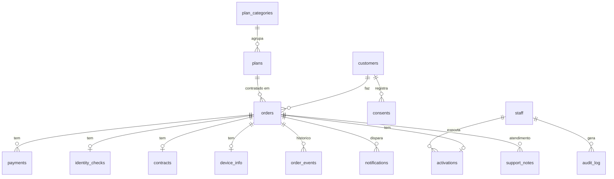

# 04 — Modelo de dados

Rascunho para discussão. Será convertido em migrações SQL na fase 1. Convenções: `id uuid`,
`created_at`/`updated_at timestamptz`, valores em **centavos** (`integer`), enums em Postgres.
Campos com 🔒 são criptografados na aplicação.

## Diagrama

## Tabelas

### Catálogo

**plan_categories** — `id, name, slug, sort_order, is_active`

**plans**
| Campo | Tipo | Nota |
|-------|------|------|
| slug | text unique | URL da página do plano |
| name, short_description, description | text | |
| category_id | fk | |
| price_cents | int | Preço cobrado por nós |
| billing_mode | enum `one_time` \| `recurring` | `recurring` só após definição do modelo |
| benefits | jsonb | Lista de benefícios para comparação |
| sim_types_allowed | enum[] `esim`, `physical` | |
| vivo_reference | text | Código/nome do plano no portal Vivo (para o ativador) |
| is_active, sort_order | | |
| seo_title, seo_description | text | |

### Clientes

**customers**
| Campo | Tipo | Nota |
|-------|------|------|
| auth_user_id | fk auth.users | Login do cliente |
| full_name | text | |
| cpf_encrypted 🔒 | bytea | |
| cpf_hash | text unique | HMAC do CPF — busca e bloqueio de duplicidade |
| birth_date | date | |
| email | citext | |
| phone | text | E.164 |
| whatsapp_opt_in_at | timestamptz | Consentimento para fase 2 |

**consents** — `customer_id, type (termos|privacidade|whatsapp|marketing), document_version, granted_at, revoked_at, ip, user_agent`

### Pedidos

**orders**
| Campo | Tipo | Nota |
|-------|------|------|
| code | text unique | `GC-2026-00123` — o que aparece no WhatsApp |
| customer_id, plan_id | fk | |
| plan_snapshot | jsonb | Cópia do plano/preço no momento da compra (preço pode mudar depois) |
| amount_cents | int | |
| sim_type | enum `esim` \| `physical` | `physical` = chip lacrado comprado pelo cliente |
| device_brand, device_model | text | Para checar compatibilidade eSIM |
| is_portability | bool | Futuro |
| status | enum (doc 05) | Status principal |
| payment_status, identity_status, contract_status, device_status | enums | Sub-status do checklist |
| ready_at, activated_at, cancelled_at | timestamptz | |
| assigned_to | fk staff | Quem pegou para ativar |
| problem_reason | text | Preenchido quando status = `pendencia` |
| expires_at | timestamptz | Pedido não pago expira |

**order_events** (histórico, só inserção) — `order_id, from_status, to_status, field, actor_type (system|customer|staff|webhook), actor_id, reason, created_at`

### Pagamentos

**payments**
| Campo | Tipo | Nota |
|-------|------|------|
| order_id | fk | |
| provider | text | `asaas` |
| provider_customer_id | text | id do cliente no Asaas |
| provider_payment_id | text unique | id da cobrança — impede duplicidade |
| billing_type | enum `pix` \| `credit_card` | |
| amount_cents | int | |
| status | enum `pending`, `confirmed`, `received`, `overdue`, `refunded`, `chargeback`, `cancelled` | |
| invoice_url | text | |
| paid_at, refunded_at | timestamptz | |

Índice parcial único: **no máximo uma cobrança `pending` por pedido**.

**subscriptions** — criada só se o modelo recorrente for confirmado.

### Identidade, contrato, aparelho, ativação

**identity_checks** — `order_id, provider (manual|<provedor>), provider_reference, status, attempts, rejection_reason, reviewed_by, decided_at`
Status: `not_started`, `pending_documents`, `in_review`, `approved`, `rejected`, `retry_required`.

**identity_files** (modo manual — usado no MVP, ver D3) — `identity_check_id, kind (selfie|doc_front|doc_back), storage_path, sha256, delete_after`

**contracts**
| Campo | Nota |
|-------|------|
| order_id | |
| provider | `d4sign` |
| provider_document_uuid | unique |
| template_version | versão do modelo usado |
| pdf_sha256 | integridade |
| status | `not_created`, `queued`, `sent`, `signed`, `refused`, `cancelled`, `error` |
| signed_file_path | storage privado |
| sent_at, signed_at, last_error | |

**device_info**
| Campo | Nota |
|-------|------|
| order_id | |
| imei_encrypted 🔒 | 15 dígitos, Luhn válido |
| eid_encrypted 🔒 | 32 dígitos, só eSIM |
| iccid_encrypted 🔒 | 19–20 dígitos, só chip físico lacrado (D4) |
| imei_last4 | Para exibir/conferir sem descriptografar |
| screenshot_path | Opcional, com `delete_after` |
| source | `typed` \| `ocr_confirmed` |
| confirmed_at | Cliente confirmou os dados |

**activations**
| Campo | Nota |
|-------|------|
| order_id | |
| performed_by | fk staff |
| msisdn | Número da linha ativada |
| iccid | Copiado de `device_info` (chip físico) |
| esim_qr_path | Storage privado, apagado após confirmação de instalação |
| vivo_protocol | Protocolo do portal Vivo |
| notes | |
| activated_at | |

### Comunicação e integração

**notifications** (outbox) — `order_id, channel (email|whatsapp), template, payload, status (queued|sent|failed), scheduled_for, attempts, sent_at, provider_message_id, last_error`

**webhook_events** (inbox) — `provider, event_id, event_type, payload, received_at, processed_at, attempts, last_error` · **unique(provider, event_id)**

**integration_jobs** — fila genérica para chamadas com limite de taxa (ex.: D4Sign): `kind, order_id, status, run_after, attempts, last_error`

### Equipe e auditoria

**staff** — `auth_user_id, name, role (owner|admin|ativador|atendente|financeiro), is_active, mfa_required`

**audit_log** (só inserção, sem update/delete por política) — `actor_id, action, entity, entity_id, metadata, ip, created_at`
Exemplos de `action`: `reveal_cpf`, `reveal_imei`, `order_status_change`, `plan_price_change`, `staff_role_change`, `login`.

**support_notes** — `order_id, customer_id, staff_id, channel, note, created_at`

**data_requests** (LGPD) — `customer_id, type (export|delete|correct), status, handled_by, created_at, done_at`

## Regras de acesso (resumo)

- RLS ativo em **todas** as tabelas.
- Cliente: lê apenas os próprios `orders`, status e checklist; nunca lê campos criptografados de volta (o servidor mostra mascarado).
- Equipe: acesso só via servidor com checagem de função; leitura de 🔒 gera registro em `audit_log`.
- `audit_log`, `order_events`, `webhook_events`: sem UPDATE/DELETE para ninguém pela aplicação.
