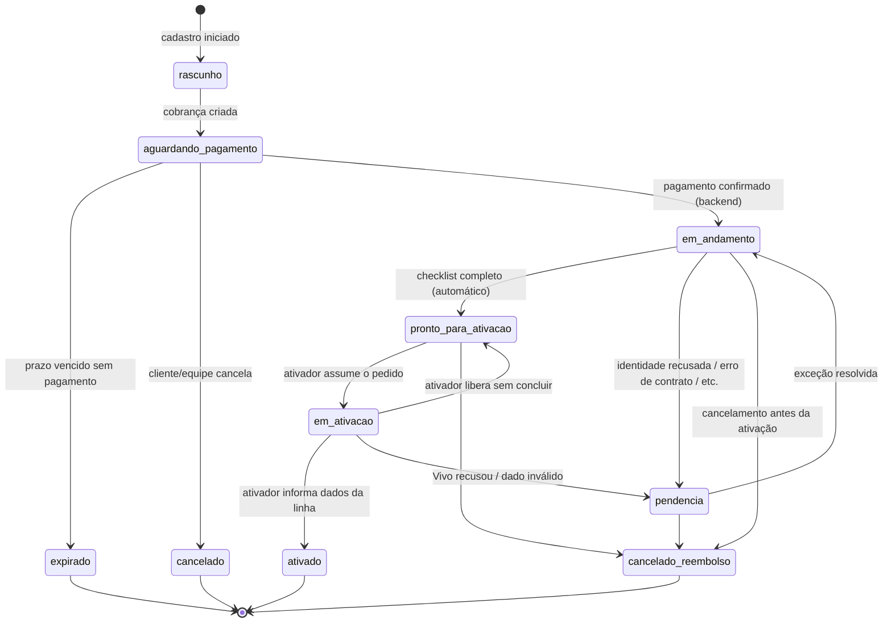

# 05 — Estados do pedido e regras de transição

O pedido tem **um status principal** (onde ele está na esteira) e **quatro sub-status** (o
checklist). O status principal muda sozinho a partir dos sub-status, exceto nas etapas manuais.

## Status principal



| Status | Significado | Quem move |
|--------|------------|-----------|
| `rascunho` | Cadastro básico em preenchimento | Cliente |
| `aguardando_pagamento` | Cobrança PIX criada | Sistema |
| `em_andamento` | Pago; cliente concluindo identidade/contrato/aparelho | Sistema |
| `pronto_para_ativacao` | Tudo pronto — aparece na fila do ativador | **Sistema (automático)** |
| `em_ativacao` | Um ativador assumiu (evita dois mexendo no mesmo pedido) | Equipe |
| `ativado` | Linha ativa, cliente notificado | Equipe |
| `pendencia` | Precisa de ação humana (motivo obrigatório) | Sistema ou equipe |
| `expirado` | Não pagou no prazo | Sistema |
| `cancelado` | Cancelado sem pagamento | Cliente/equipe |
| `cancelado_reembolso` | Cancelado após pagamento; reembolso registrado | Equipe (admin) |

## Sub-status (checklist)

| Sub-status | Valores | Concluído quando |
|-----------|---------|------------------|
| `payment_status` | `pending`, `confirmed`, `received`, `overdue`, `refunded`, `chargeback`, `cancelled` | `confirmed` ou `received` (confirmado pela API) |
| `identity_status` | `not_started`, `pending_documents`, `in_review`, `approved`, `rejected`, `retry_required` | `approved` |
| `contract_status` | `not_created`, `queued`, `sent`, `signed`, `refused`, `cancelled`, `error` | `signed` |
| `device_status` | `pending`, `submitted`, `confirmed`, `invalid` | `confirmed` |

## Regras

1. **Regra do "pronto"** (função no banco, executada a cada mudança de sub-status, dentro da mesma transação):
   ```
   SE status = em_andamento
      E payment_status ∈ {confirmed, received}
      E identity_status = approved
      E contract_status = signed
      E device_status = confirmed
   ENTÃO status := pronto_para_ativacao, ready_at := now()
   ```
2. **Pagamento só muda pelo backend** após webhook autenticado **e** consulta à API do Asaas.
3. **Contrato é enviado assim que o pagamento é confirmado** (D21), em paralelo à validação de identidade.
4. **Dados do aparelho/chip** podem ser enviados a qualquer momento depois do pagamento; IMEI
   precisa passar no Luhn; **EID** obrigatório se `sim_type = esim`; **ICCID** obrigatório se
   `sim_type = physical` (chip lacrado comprado pelo cliente).
5. **Pendência automática**:
   - `identity_status = rejected` após o limite de tentativas (ex.: 3);
   - `contract_status = error` após o limite de tentativas da fila;
   - `contract_status = refused` (cliente recusou assinar);
   - `payment_status ∈ {refunded, chargeback}` em qualquer momento antes de `ativado`.
6. **Chargeback/estorno depois de `ativado`**: não muda o status, mas cria alerta crítico no painel
   (a linha já existe — decisão humana).
7. **`em_ativacao`** guarda `assigned_to`. Só quem assumiu (ou admin) conclui. Se ficar mais de X
   horas parado, volta para a fila com alerta.
8. **`ativado`** exige: número da linha (MSISDN); para eSIM, o QR Code ou a confirmação de que a Vivo o entregou.
   Ao salvar, dispara a notificação ao cliente.
9. **Toda transição** grava `order_events` (de → para, quem, motivo). Transições não listadas acima
   são rejeitadas pelo código de domínio.
10. **Cancelamento após pagamento** sempre pede motivo e registra o reembolso (feito no Asaas;
    o webhook de estorno confirma).

## Notificações por evento

| Evento | E-mail | Lembrete automático |
|--------|--------|--------------------|
| Cobrança criada | "Seu PIX está pronto" | 1 h e 20 h antes de expirar |
| Pagamento confirmado | Confirmação + link para a área do cliente | — |
| Identidade pendente | — | 24 h e 72 h sem concluir |
| Identidade aprovada | "Identidade aprovada, seu contrato está a caminho" | — |
| Identidade recusada / nova tentativa | Orientação para tentar de novo | — |
| Contrato enviado | "Assine seu contrato" (o link oficial vem da D4Sign) | 24 h e 72 h sem assinar |
| Contrato assinado | Se aparelho pendente: "Falta só informar IMEI/EID" | 24 h e 72 h |
| Pronto para ativação | "Recebemos tudo — ativação em até X horas" + botão WhatsApp | — |
| Ativado | Confirmação + orientações de uso / instalação do eSIM | — |
| Pendência | Mensagem específica do motivo | — |

Lembretes param assim que a etapa é concluída, e há um teto (ex.: 3 lembretes por etapa) para
não virar spam.
